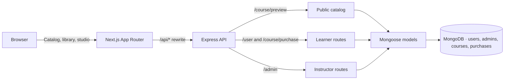

# Fieldwork

Fieldwork is a course-selling demo built with Next.js, Express, and MongoDB. Visitors can search the catalog and browse courses by category. Learners can enroll and revisit purchases in their library. Instructors can publish, edit, and remove their own courses. Enrollment simulates a purchase without collecting payment details.

## Features

- **Course catalog.** Browse on desktop or mobile, search titles and descriptions, filter by category, and view course details and USD prices.
- **Learner and instructor accounts.** Register, sign in, and sign out under either role. Sessions survive page refreshes in the same tab and expire after eight hours.
- **Simulated purchases.** Enroll in a course without entering payment details. Each learner can enroll in a given course once.
- **Learner library.** View and search enrolled courses, including courses an instructor has since removed from the catalog.
- **Instructor studio.** Publish, list, edit, and archive your own courses. Set the title, description, category, and price. Supply a cover image URL or use the bundled category artwork.
- **API and storage.** Access catalog, account, course management, and purchase operations through the Express API. MongoDB stores accounts, courses, and enrollments. The API validates inputs, hashes passwords, and enforces role and ownership checks.
- **Demo setup.** Generate local configuration and signing secrets, then seed three sample courses. Running the seed command again preserves existing courses.

## Quick start

Use Node.js 22.13+ or 24 LTS, npm, and a running MongoDB instance. Run the npm commands from the repository root.

**Start MongoDB**. If you want to run MongoDB locally in Docker, create the container once:

```sh
docker run -d --name fieldwork-mongo -p 127.0.0.1:27017:27017 -v fieldwork-mongo-data:/data/db mongo:8

# If deleting container should delete the entire DB
docker run -d --name fieldwork-mongo -p 127.0.0.1:27017:27017 mongo:8
```

On later runs, use `docker start fieldwork-mongo` if the container is stopped.

**Terminal 1 · Start the API**

```sh
npm ci --prefix backend
npm run setup --prefix backend
npm run seed --prefix backend
npm start --prefix backend
```

Setup creates `backend/.env` with separate random signing secrets for learners and instructors. It preserves an existing file. The default database URI is `mongodb://127.0.0.1:27017/fieldwork`. To use another MongoDB instance, set `MONGO_DB_URI` in that file before seeding. The seed command adds three sample courses and can be run again safely.

**Terminal 2 · Start the frontend**

```sh
npm ci --prefix frontend
npm run dev --prefix frontend
```

Open [Fieldwork on localhost](http://localhost:3000). The API listens on port 4000 by default. To use another API port, set `PORT` in `backend/.env` and `API_BASE_URL` in `frontend/.env.local` to the corresponding origin, then restart both processes.

## Architecture



The browser calls the frontend on one origin. Next.js forwards API requests to Express. Express validates inputs with Zod, hashes passwords with bcrypt, and issues role-specific JWTs that expire after eight hours. The browser keeps the signed-in session in tab-scoped session storage. Instructor updates include the owner ID in the database query. A unique index on learner and course IDs prevents duplicate enrollments.

## API routes

Paths below are relative to the Express server. Protected endpoints accept `Authorization: Bearer <token>` or the original `token` header.

| Method | Path | Access | Purpose |
| --- | --- | --- | --- |
| POST | `/user/signup`, `/admin/signup` | Public | Register with firstName, lastName, email and password |
| POST | `/user/signin`, `/admin/signin` | Public | Exchange email and password for a session token |
| GET | `/course/preview` | Public | List catalog courses |
| POST | `/course/purchase` | Learner | Enroll using courseId |
| GET | `/user/purchases` | Learner | Retrieve purchases and course details |
| POST | `/admin/create` | Instructor | Publish a course |
| GET | `/admin/course/bulk` | Instructor | List the instructor's active courses |
| PUT | `/admin/course` | Instructor | Update courseId with one or more course fields |
| DELETE | `/admin/course/:id` | Instructor | Remove a course from the catalog |
